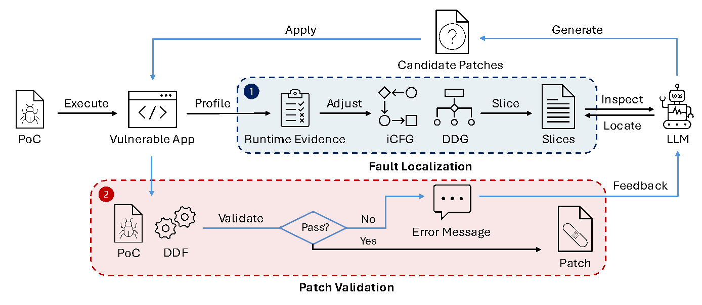
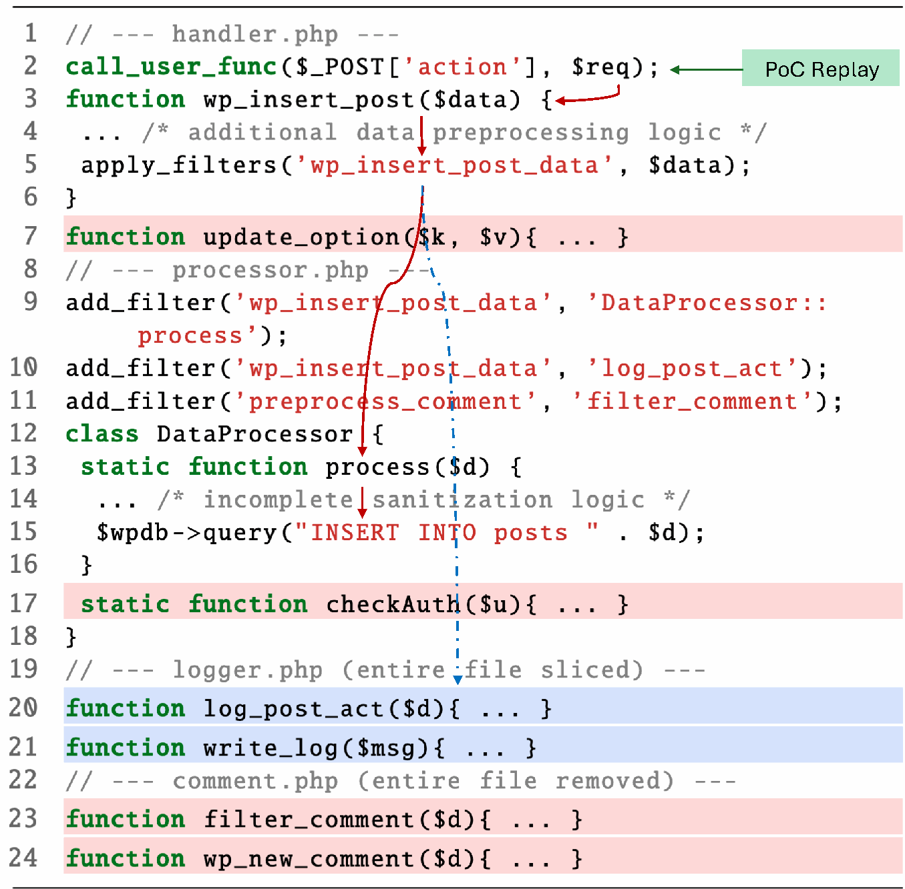
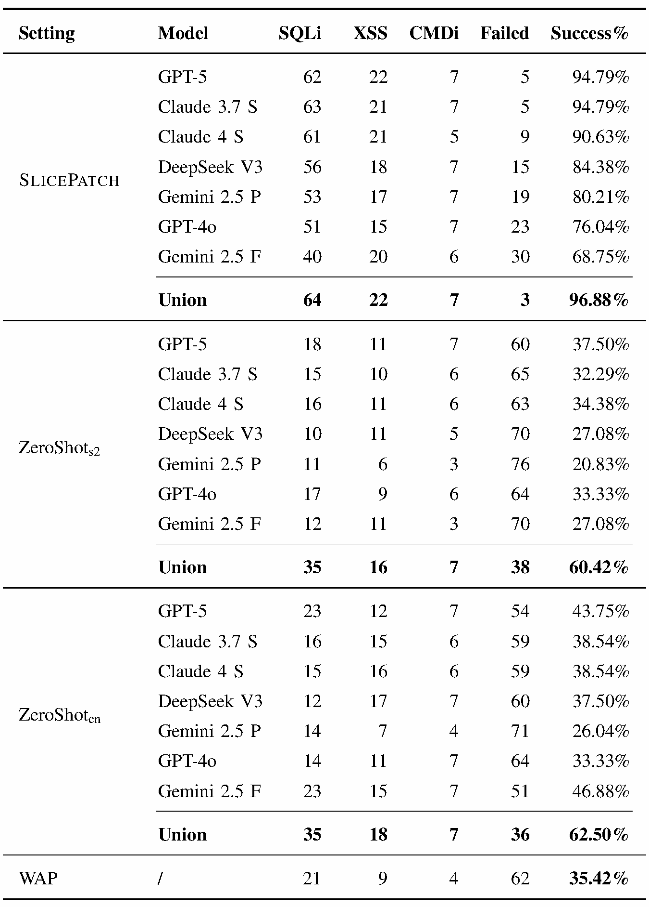
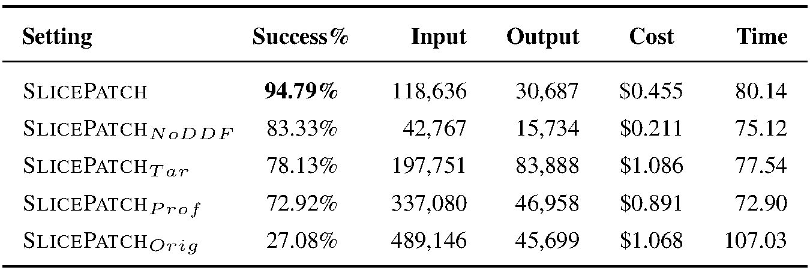

- 선정 논문: Web Application Vulnerability Repair via Context-Aware Fault Localization and Directed Differential Fuzzing
- 게재 학회 및 연도: IEEE Symposium on Security and Privacy, 2026
- 저자: Chenlin Wang, Wei Meng
- DOI: 10.1109/SP63933.2026.00237

## 배경 / 문제 정의

### 논문을 읽기 전에

#### 이 논문이 다루는 문제는 무엇인가?

AI가 웹 프로그램의 취약점을 고치고, 그 수정이 보안 문제를 해결하면서 기존 기능도 유지하는지 확인하는 문제를 다룬다.

#### 왜 이 문제가 중요한가?

수정 코드가 만들어졌다고 해서 제대로 고쳐졌다는 보장은 없기 때문이다. 취약점이 남아 있거나 정상 기능이 손상될 수 있어, 실제 실행을 통한 확인이 필요하다.

#### 기존 방식들은 무엇이 부족했는가?

AI에게 일부 코드만 주면 필요한 정보를 놓치고, 전체 코드를 주면 입력 길이를 넘길 수 있다. 또 실행 중에 정해지는 코드의 연결 관계를 파악하기 어렵고, 수정 결과를 확인할 테스트도 부족했다.

### 이 논문을 선택한 이유

최근 AI를 활용한 자동화 연구에 관심을 가지면서, 나도 이를 보안 분야에 어떻게 적용할 수 있을지 고민하고 있다. 특히 AI가 보안 문제를 고쳤을 때 그 결과를 어디까지 믿을 수 있는지가 궁금했다. 이 논문은 수정 코드를 만드는 과정부터 결과를 검사하는 과정까지 다룬다는 점에서 읽어 보고 싶었다.

주요 용어 정리

| 용어 | 설명 |
| --- | --- |
| PHP | 서버에서 실행되며 웹 페이지와 웹 서비스의 기능을 만드는 데 쓰는 프로그래밍 언어다. |
| 패치(Patch) | 프로그램의 오류나 보안 취약점을 고치기 위해 기존 코드에 적용하는 수정 내용이다. |
| PoC(Proof of Concept) | 취약점이 실제로 발생함을 보여 주는 재현 코드나 절차다. |
| 자동 취약점 수정(AVR, Automated Vulnerability Repair) | 이미 발견된 보안 취약점을 고치는 패치를 자동으로 만드는 기술이다. |
| 문맥 창·입력 길이 제한(Context Window) | AI가 한 번에 처리할 수 있는 정보량의 한도다. |
| 제로샷(Zero-shot) | AI에게 정답 예시를 미리 보여 주지 않고 지시와 입력만으로 작업을 시키는 방식이다. |
| Dynamic Construct Staticization | 분석용 코드에서 실행 중에 정해지는 파일 경로나 클래스·함수 이름을 실제로 확인한 값으로 바꾸는 과정이다. |
| 함수 간 제어 흐름 그래프(iCFG) | 함수 내부의 실행 순서와 함수 간 호출·복귀 관계를 나타낸 그림이다. |
| 데이터 의존 그래프(DDG) | 어떤 코드에서 만든 값을 다른 코드가 사용하는 관계를 나타낸 그림이다. |
| 프로그램 슬라이싱(Program Slicing) | 프로그램 전체에서 특정 값이나 동작과 관련된 코드만 골라내는 분석 방법이다. |
| 방향성 퍼징(Directed Fuzzing) | 특정 코드 위치에 도달하도록 입력을 만들거나 바꾸는 자동 테스트다. |
| 차등 검사(Differential Testing) | 같은 입력을 서로 다른 프로그램이나 버전에 넣어 실행 결과를 비교하는 테스트다. |
| 차등 퍼징(Differential Fuzzing) | 입력을 자동으로 만들거나 바꿔 가며 여러 프로그램이나 버전의 실행 결과를 비교하는 테스트다. |
| 방향성 차등 퍼징(Directed Differential Fuzzing) | 특정 코드 위치에 도달하도록 입력을 만들거나 바꾸면서 수정 전후 프로그램의 실행 결과를 비교하는 자동 테스트다. |
| 기반 퍼저 | 입력을 자동으로 만들거나 바꿔 프로그램을 검사하며, 검증 시스템의 바탕으로 쓰이는 도구다. |
| 퍼징 인스턴스(Fuzzing Instance) | 입력을 바꿔 가며 프로그램을 반복 검사하도록 실행한 퍼징 도구 하나를 뜻한다. |
| 기능 회귀·기능 손상(Functional Regression) | 코드를 수정한 뒤 기존에 정상적으로 작동하던 기능에 오류가 생기는 현상이다. |
| 제거 실험(Ablation Study) | 구성 요소를 빼거나 바꿔 성능이 얼마나 달라지는지 확인하는 실험이다. |
{: .glossary-table }

## 핵심 아이디어

SlicePatch는 PHP로 작성된 웹 프로그램의 보안 문제를 고치는 시스템이다. 프로그램의 소스코드와 문제를 다시 일으킬 수 있는 재현 자료인 PoC를 받는다. 이를 이용해 문제가 생기는 위치를 찾고, AI가 수정 코드인 패치를 만들게 한 뒤 실제 프로그램에 적용해 검사한다. 이처럼 수정 코드를 자동으로 만드는 기술을 자동 취약점 수정이라고 한다.

SlicePatch는 코드를 읽고 수정안을 만드는 대규모 언어 모델(LLM)을 사용한다. 검사에서 문제가 발견되면 실패한 이유를 LLM에 알려 주어 다시 수정하게 한다.

전체 흐름은 다음과 같다.

PoC 실행 → 실행 기록 수집 → 관련 코드 추출 → AI 패치 생성 → 적용 및 검증 → 실패 원인을 반영해 재수정

내가 이해한 핵심은 AI가 수정하기 전에 필요한 자료를 준비하고, 수정한 뒤에는 결과를 직접 검사한다는 점이다. 이 두 과정이 있어야 AI가 만든 코드가 문제를 해결했는지 판단할 수 있다.

## 방법론과 시스템 구성

### 전체 구조

{: .paper-figure }

원문 Figure 1. SlicePatch의 전체 아키텍처. 
출처: Chenlin Wang and Wei Meng, IEEE S&P 2026.
{: .paper-caption }

그림의 위쪽에서는 PoC를 실행해 취약점과 관련된 코드를 추린다. 오른쪽 LLM이 패치를 만들면 원본 프로그램에 적용하고, 아래쪽에서 기존 PoC와 추가 테스트로 확인한다. 실패하면 오류 정보를 LLM에 돌려줘 다시 수정하게 한다.

### 취약점을 실행하고 관련 코드 추리기

#### 실행 기록으로 분석 대상 좁히기

먼저 PoC를 실행하면서 어떤 파일과 함수가 사용됐는지 기록한다. 함수는 특정 작업을 맡는 코드 묶음이다. 실행되지 않은 함수는 분석 자료에서 덜어내고, 실행된 함수는 전체 내용을 남긴다. 관련 데이터와 함수를 묶는 단위인 클래스의 정보도 필요한 만큼 보존해 코드 사이의 관계를 살펴볼 수 있게 한다.

실행 중에 정해진 파일 경로나 함수 이름도 기록에 남는다. SlicePatch는 실제로 확인한 경로와 이름을 분석용 코드에 반영한다. 그러면 분석 도구가 어떤 파일과 함수를 따라가야 하는지 알 수 있다. 이 과정을 Dynamic Construct Staticization이라고 한다.

#### 슬라이싱으로 관련 코드 추리기

이후 LLM이 문제가 있을 만한 위치를 찾으면, 코드 분석 도구가 그 위치에 영향을 주는 코드를 찾아간다. 어떤 값이 전달됐는지, 그 값을 어디서 만들거나 바꿨는지, 어떤 조건에서 코드가 실행되는지를 확인한다. 이렇게 관련된 코드를 골라내는 방법이 프로그램 슬라이싱이다.

분석할 때는 코드의 실행 순서와 함수 간 연결을 나타내는 iCFG, 코드 사이에서 값이 사용되는 관계를 나타내는 DDG를 이용한다. 두 관계를 살펴보며 수정에 필요한 부분을 모은다.

{: .paper-figure }

원문 Figure 2. WordPress 스타일의 단순화된 코드 예시. 
출처: Chenlin Wang and Wei Meng, IEEE S&P 2026.
{: .paper-caption }

그림의 빨간 실선은 분석 후에도 남는 취약점 관련 경로이고, 빨간 배경은 PoC 실행에서 호출되지 않아 제외된 함수다. 파란 부분은 실행되었더라도 추가 슬라이싱에서 제외된 코드다. 로그를 남기는 `log_post_act` 함수는 취약한 `process` 함수에 영향을 주는 경로에 포함되지 않아 빠진다.

코드를 추리는 목적은 AI에게 필요한 자료를 정리해 주는 것이다. AI는 이 자료를 보고 수정안을 만들고, 실제 패치는 원본 프로그램의 해당 위치에 적용된다. 코드의 양을 줄이면서도 수정에 필요한 연결 관계를 남기는 것이 중요하다.

### 패치 생성과 재수정

LLM에는 취약점 설명, PoC, 추린 코드를 전달한다. 이전 수정이 실패했다면 그 이유도 함께 준다. 모델은 이 정보를 바탕으로 어느 부분을 어떤 코드로 바꿀지 답한다. 정답이 들어 있는 예시를 미리 보여 주지 않고 작업 지시와 자료를 주는 제로샷 방식이다.

AI에게 보여 준 코드에는 일부 내용이 빠져 있으므로 원본과 구조가 다를 수 있다. SlicePatch는 원본에서 수정할 위치를 찾아 AI의 답을 적용한다. 그다음 검사 결과를 보고 추가 수정이 필요한지 판단한다.

### 원래 공격과 바뀐 입력으로 확인하기

#### 원래 PoC로 취약점 재확인하기

먼저 수정한 프로그램을 대상으로 원래 PoC를 다시 실행해, 같은 취약점이 남아 있는지 확인한다. 통과한 뒤에도 입력을 바꿔 가며 추가로 검사한다. 입력이 달라지면 문제가 다시 생길 수 있고, 패치 때문에 기존 기능이 망가지는 기능 손상이 생길 수도 있기 때문이다.

#### 바뀐 입력으로 수정 전후 비교하기

이 단계에서는 입력을 만들거나 바꾸면서, 검사하려는 코드가 실제로 실행되도록 한다. 이처럼 특정 코드 위치에 도달하도록 검사하는 방법이 방향성 퍼징이다.

같은 입력을 수정 전후 프로그램에 넣고 결과를 비교하는 방법은 차등 검사다. SlicePatch는 두 방법을 결합한 방향성 차등 퍼징을 사용한다. 수정한 코드가 실제로 실행되게 하면서, 수정 전후에 동작이 어떻게 달라졌는지 살펴보는 것이다.

정상 요청은 기존 기능을 유지해야 하고, 취약점을 일으키는 요청은 수정 후 같은 문제를 일으키지 못해야 한다. 수정과 무관하게 실행할 때마다 달라지는 값은 비교에서 제외하거나 같은 형태로 맞춰, 이런 차이를 오류로 잘못 판단하지 않도록 한다.

#### 실패 원인을 다음 수정에 반영하기

검사에서 문제가 발견되면 취약점이 남아 있는지, 실행 중 오류가 났는지, 정상 기능이 망가졌는지를 LLM에 알려 준다. LLM은 이 결과를 보고 다시 수정한다. 계속 실패하면 처음에 문제 위치를 잘못 찾았을 가능성도 확인한다. 기존 테스트가 부족해도 PoC와 새로 만든 입력을 이용해 수정 결과를 검사하는 방식이다.

## 실험 및 평가 결과

### 무엇을 대상으로 평가했나

PHP 웹 프로그램 12개의 실제 취약점 96개를 대상으로 평가했으며, LLM은 7개를 사용했다. 취약점은 SQL 인젝션 67개, XSS 22개, 명령어 인젝션 7개였다.

SQL 인젝션은 데이터베이스 명령을 조작하는 취약점이다. XSS는 사용자 브라우저에서 악성 스크립트를 실행시키는 취약점이고, 명령어 인젝션은 서버에서 의도하지 않은 시스템 명령을 실행시키는 취약점이다.

비교 대상은 코드를 실행하지 않고 분석하는 도구 WAP와 LLM을 이용하는 기존 ZeroShot 방식이다. 비교 도구에는 필요한 취약점 위치 정보를 미리 제공했다. 패치 하나를 검사할 때는 자동 테스트를 돌리는 실행 단위인 퍼징 인스턴스 24개를 한 시간 동안 실행했다. 성공한 패치는 사람이 다시 검토했다.

### 얼마나 잘 고쳤나

{: .paper-figure }

원문 Table 2. 모델·방식별 취약점 수정 성능. 
출처: Chenlin Wang and Wei Meng, IEEE S&P 2026.
{: .paper-caption }

표의 s2는 취약한 코드를 지우고 AI가 채우는 Simple 2, cn은 주석으로 남긴 코드를 참고해 수정하는 Commented Code 방식이다.

GPT-5 기준 성공률은 SlicePatch 94.79%, s2 37.50%, cn 43.75%였다. WAP는 35.42%였다.

Claude 3.7 Sonnet을 쓴 SlicePatch도 91개를 수정했다. 표의 Union 96.88%는 여러 모델 중 하나라도 수정에 성공한 취약점을 중복 없이 합친 결과다. 모델 하나의 성능은 개별 행에서 확인해야 한다.

### 어떤 과정이 도움이 됐나

각 과정이 수정 성능에 얼마나 도움이 되는지는 제거 실험으로 확인했다. 패치를 추가로 검사하는 방향성 차등 퍼징을 빼거나, AI에게 제공하는 코드의 범위를 취약한 함수만·실행된 코드만·전체 코드로 바꿔 수정 성공률을 비교했다.

{: .paper-figure }

원문 Table 6. 문맥 구성 및 차등 퍼징의 효과를 비교한 제거 실험. 
출처: Chenlin Wang and Wei Meng, IEEE S&P 2026.
{: .paper-caption }

차등 퍼징을 뺀 NoDDF의 성공률은 83.33%로 내려갔다. 취약한 함수만 보여 준 Tar는 78.13%, 실행된 코드를 추가 슬라이싱 없이 제공한 Prof는 72.92%, 전체 코드를 넣은 Orig는 27.08%였다.

전체 코드를 넣은 경우에는 실패 70건 중 50건이 입력 길이 제한 때문이었다. 수정과 관련된 내용을 고르는 것뿐 아니라, AI가 실제로 읽을 수 있는 양으로 자료를 줄이는 일도 중요했다.

검사에서 발견된 잘못된 패치 시도의 64.30%는 원래 PoC로 걸러졌고, 35.70%는 차등 퍼징에서 걸러졌다. 35.70%는 처음의 PoC를 통과한 뒤에도 추가 검사에서 문제가 발견된 비율이다. 두 비율은 반복 수정 과정에서 검사로 찾아낸 잘못된 패치 시도 전체를 기준으로 한다.

### 시간과 비용은 어땠나

GPT-5 설정에서 취약점 하나를 처리하는 데 평균 80.14분이 걸렸고, LLM 사용 비용은 0.455달러였다. 실험 당시의 값이며 서버 운영과 사람의 검토에는 별도 비용이 든다. 실제로 써 본다면 성공률뿐 아니라 이 검증 시간도 따져 볼 것 같다.

## 한계점 및 아쉬운 점

### 적용 범위가 좁다

SlicePatch는 동작하는 PoC가 있어야 실행 기록을 얻을 수 있다. 재현하기 어려운 취약점에는 적용이 어렵고, 평가도 PHP의 SQL 인젝션·XSS·명령어 인젝션에 집중되어 있다. 다른 언어나 유형으로 넓히려면 그 환경에 맞는 분석 도구와 검사 방법이 필요하다.

### 검증 도구도 잘못 판단할 수 있다

수정 전후 프로그램의 데이터베이스나 권한 상태가 달라져 응답에 차이가 생기자, 올바른 패치가 실패로 판정된 경우도 있었다. 수정한 코드가 아닌 프로그램 상태의 차이를 오류로 판단한 것이다. 검사 전 상태로 되돌리는 방법이 제시됐지만, 처리 효율과 구현의 복잡성 때문에 실험에는 적용되지 않았다.

반대로 잘못된 패치가 로그인을 막아 테스트가 진행되지 않았는데, 정해진 시간 동안 문제가 발견되지 않아 통과한 사례도 있었다. 이후 로그인이 계속 실패하면 검증 실패로 처리하도록 기반 퍼저가 수정됐다.

나는 이 사례가 특히 기억에 남았다. 결과에 문제가 없다고 표시됐더라도 테스트가 실제로 어디까지 진행됐는지 확인해야 믿을 수 있기 때문이다.

### 내가 더 확인하고 싶은 점

평가 대상은 SQL 인젝션의 비중이 높고, 공개된 PoC로 재현할 수 있는 사례를 중심으로 구성됐다. 다른 유형이나 재현이 어려운 취약점에서도 비슷한 결과가 나오는지는 더 확인해야 한다.

## 내가 보기에 앞으로 이어서 해볼 만한 방향

### 느낀 점과 배운 점

처음에는 수정 절차를 다듬는 것보다 더 좋은 AI 모델을 쓰는 편이 효과적일 것이라고 예상했다. 하지만 같은 모델에서도 어떤 코드를 보여 주고 실패한 이유를 어떻게 전달하느냐에 따라 결과가 크게 달라졌다. 이를 보며 모델 자체의 성능보다 AI를 활용하는 방식이 수정 결과에 더 큰 영향을 줄 수도 있겠다고 느꼈다.

AI가 만든 코드를 이해하려면 어디를 왜 고쳤는지, 어떤 테스트로 확인했는지를 내 말로 설명할 수 있어야 할 것 같다. 특히 검증 도구가 잘못 판단한 사례를 보면서, 통과했다는 결과를 믿으려면 테스트가 제대로 수행됐는지부터 살펴야 한다는 점을 배웠다.

### 이 논문을 바탕으로 더 읽어볼 논문

AI 자동화에 대한 관심을 이어가기 위해 PatchAgent를 먼저 읽고, 이후 Predator로 검증 기술을 더 살펴보려 한다. 두 논문은 SlicePatch의 참고문헌에 포함되어 있다.

#### PatchAgent — AI가 코드를 수정하는 전체 과정

- 논문 제목: PATCHAGENT: A Practical Program Repair Agent Mimicking Human Expertise
- 학회·연도: USENIX Security 2025

PatchAgent는 문제가 있는 코드 위치를 찾고, 패치를 만들고, 결과를 검증하는 과정을 하나의 LLM 기반 에이전트로 연결한 연구다. 여기서 에이전트는 AI가 코드 탐색과 검사 도구를 사용하며 수정 작업을 이어 가는 시스템을 뜻한다.

SlicePatch와 비교하며 다음 질문을 중심으로 읽어 보고 싶다.

- 수정에 필요한 코드를 어떻게 찾아오는가?
- 검증 결과를 다음 수정에 어떻게 반영하는가?
- 코드 정보를 제공하는 방식과 검증 방식은 SlicePatch와 어떻게 다른가?

같은 모델이라도 활용 방식에 따라 성과가 달라진다는 점에 관심이 생겼는데, 그 관심을 이어 가기 좋은 연구라고 생각한다.

#### Predator — 방향성 퍼징을 더 이해하기

- 논문 제목: Predator: Directed Web Application Fuzzing for Efficient Vulnerability Validation
- 학회·연도: IEEE S&P 2025

Predator는 검사하려는 코드까지 실행이 도달하도록 입력을 조절하며 웹 취약점을 확인하는 방향성 퍼징 연구다.

SlicePatch는 이 도구를 확장해 같은 입력을 수정 전후 프로그램에 보내고 결과를 비교한다. Predator를 읽으며 목표 코드까지 실행을 유도하는 방법을 이해하고, SlicePatch가 여기에 차등 검사를 결합한 이유를 더 살펴볼 수 있지 않을까 싶다.

### 비교해 보고 싶은 포인트

이 논문은 PHP 웹 애플리케이션을 대상으로 했기 때문에, 다른 언어로 작성된 프로그램에서도 비슷한 효과를 얻을 수 있을지 궁금해졌다. 앞으로는 Python 같은 다른 언어로 만든 작은 웹 프로그램에도 필요한 코드를 추려 제공하고 수정 결과를 검증하는 방식을 적용해 볼 계획이다. 같은 AI 모델과 비슷한 기능을 가진 예제로 취약점을 제대로 수정하는지와 기존 기능을 유지하는지를 비교하면, 언어가 달라져도 이 접근이 효과적인지, 어떤 부분을 바꿔야 하는지 알 수 있을 것이다.
