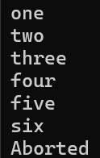
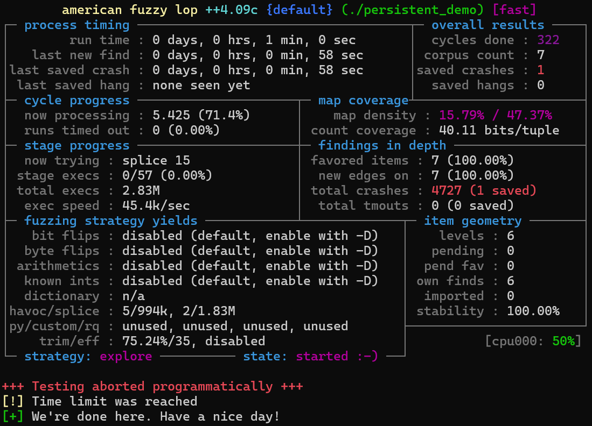
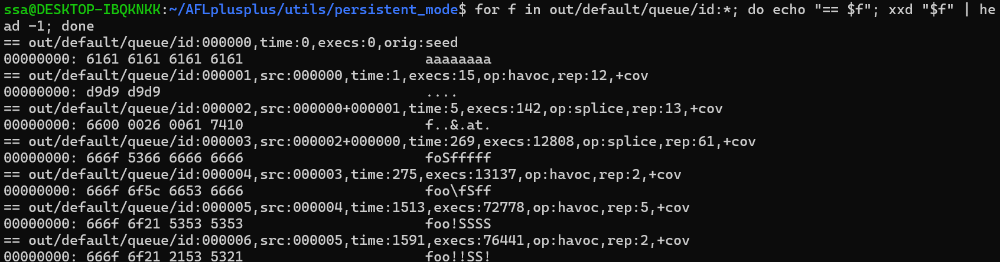
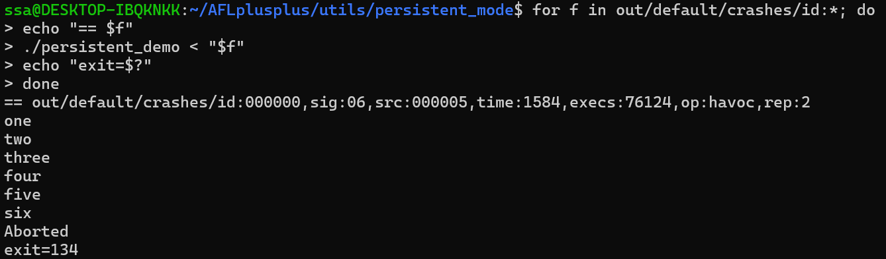
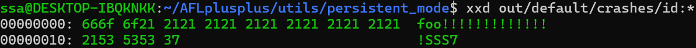

<details class="glossary-details" markdown="1">
<summary>용어 정리</summary>

| 용어 | 설명 |
| --- | --- |
| 시드(Seed) | 퍼징을 시작할 때 사용하는 초기 입력이다. |
| 코퍼스(Corpus) | 퍼징에 사용하는 입력들의 모음이다. 시드와 테스트 중 새로 추가된 입력 등이 포함된다. |
| 변이(Mutation) | 기존 입력의 값을 바꾸거나 데이터를 추가·삭제해 새로운 입력을 만드는 작업이다. |
| 표준입력(stdin) | 프로그램이 데이터를 받는 기본 통로이다. 키보드나 파일의 내용을 전달할 수 있다. |
| 계측(Instrumentation) | 프로그램의 실행 정보를 수집할 수 있도록 코드나 실행 과정에 장치를 추가하는 것이다. |
| 커버리지(Coverage) | 실행 중 프로그램의 어느 코드나 분기를 거쳤는지 나타내는 정보이다. |
| 하네스(Harness) | 퍼저가 만든 입력을 검사할 함수나 코드에 전달하는 연결 코드이다. |
| 크래시(Crash) | 프로그램이 비정상적으로 종료되는 현상이다. |
| 재현 | 문제가 발생했던 입력을 다시 넣어 같은 현상이 나타나는지 확인하는 과정이다. |
| 오라클(Oracle) | 입력을 처리한 결과가 오류인지 판단하는 기준이나 검사 장치이다. |
| Sanitizer(오류 탐지기) | 프로그램 실행 중 잘못된 메모리 사용이나 연산을 찾아내는 도구들의 묶음이다. |
| ASan(AddressSanitizer) | 범위를 벗어난 메모리 접근이나 해제된 메모리의 사용 등을 탐지한다. |
| UBSan(UndefinedBehaviorSanitizer) | 부호 있는 정수 오버플로처럼 정의되지 않은 동작 중 일부를 탐지한다. |
| MSan(MemorySanitizer) | 초기화되지 않은 값의 사용을 탐지한다. |
{: .glossary-table }

</details>

## 1. Fuzzing의 개념과 동작

### 1) Fuzzing과 Fuzzer란?

Fuzzing(퍼징)은 프로그램에 여러 값을 자동으로 넣어 보면서 문제가 생기는지 확인하는 테스트 방법이다. 여기서 프로그램에 넣는 값을 입력이라고 한다.

Fuzzer(퍼저)는 이 작업을 대신 해 주는 도구이다. 사람이 입력을 하나씩 만들어 넣는 대신, 퍼저가 입력을 계속 바꿔 가며 프로그램을 수없이 반복해서 실행한다.

문제가 생기면 그때 사용한 입력을 저장해 두기 때문에, 나중에 같은 상황을 다시 만들어 원인을 찾을 수 있다.

퍼저가 찾아낸 입력이 어떤 오류를 일으키는지는 재현과 코드 분석을 통해 확인해야 한다.

### 2) Fuzzing이 필요한 이유

프로그램에 들어갈 수 있는 입력은 셀 수 없이 많아서, 사람이 모두 직접 시험해 볼 수는 없다. 퍼징은 이 작업을 자동으로 반복하기 때문에 평소에는 잘 드러나지 않는 오류를 찾는 데 도움이 된다.

잘못된 입력을 안전하게 거절하는지도 확인할 수 있다. 예상하지 못한 입력이 들어오더라도 프로그램이 계속 정상적으로 동작해야 한다는 점에서 보안 검사에도 쓰인다.

### 3) Fuzzing의 진행 과정

퍼징은 검사할 대상을 정하고 입력과 실행 환경을 준비한 뒤, 테스트를 실행하고 발견된 오류를 분석하는 순서로 진행한다.

#### (1) 검사할 대상을 정한다

프로그램 전체를 검사할지, 프로그램 안의 특정 함수만 검사할지 정한다. 그리고 대상이 데이터를 어떻게 받는지도 확인한다.

파일을 읽는지, 키보드로 입력하는 것처럼 데이터를 직접 받는지(표준입력), 함수에 값을 전달받는지(함수 인자)에 따라 퍼저를 설정하는 방법이 달라진다.

#### (2) 처음에 넣을 입력을 준비한다

입력을 만드는 방식에 맞춰 시작에 필요한 자료를 준비한다.

변이 기반 퍼징에서는 처음에 사용할 입력인 시드(Seed)를 준비한다. 프로그램이 정상적으로 처리하는 작은 파일을 사용하는 경우가 많으며, 퍼징에 사용하는 입력들의 모음을 코퍼스(Corpus)라고 한다.

생성 기반 퍼징에서는 입력을 새로 만들 수 있도록 데이터의 형식이나 생성 규칙을 준비한다.

#### (3) 퍼저를 설정하고 실행한다

사용할 도구를 고른 뒤 검사할 프로그램, 입력을 넣는 방식, 결과를 저장할 위치 등을 설정한다.

커버리지를 활용하는 퍼징에서는 프로그램의 실행 흔적을 수집할 수 있도록 계측(Instrumentation)을 준비한다. 소스 코드를 빌드하는 방식이라면 퍼저가 지원하는 컴파일러를 사용해 실행 파일에 기록용 코드를 넣는다.

이 기록으로 퍼저가 어느 코드가 실행됐는지 알 수 있다. 계측 방법은 도구와 대상에 따라 달라진다.

준비한 입력이 대상에 제대로 전달되고 정상적으로 처리되는지 확인한 뒤 퍼저를 실행한다.

#### (4) 결과를 재현하고 원인을 분석한다

퍼저가 문제를 일으킨 입력을 저장하면, 그 입력을 다시 넣어 같은 문제가 생기는지 확인한다. 이를 재현이라고 한다. 재현되면 디버거 같은 도구로 원인을 찾고, 코드를 고친 뒤 문제가 된 입력과 정상 입력을 모두 다시 넣어 본다.

### 4) Fuzzing의 작동 원리

퍼징의 기본 원리는 입력 생성, 프로그램 실행, 오류 확인을 자동으로 반복하는 것이다. 피드백을 사용하는 퍼저는 실행에서 얻은 정보를 다음 입력을 만드는 데 반영한다.

#### (1) 입력을 만든다

변이 기반 퍼징은 코퍼스에서 입력을 골라 값을 바꾸거나 데이터를 추가·삭제한다. 이렇게 기존 입력을 바꾸는 작업을 변이(Mutation)라고 한다. 생성 기반 퍼징은 정해진 형식이나 규칙을 바탕으로 입력을 새로 만든다.

#### (2) 입력을 프로그램에 넣는다

만든 입력을 파일, 표준입력, 함수 인자 등 대상이 받는 방식으로 전달하고 실행한다. 이때 퍼저의 입력을 검사할 함수나 코드에 연결하는 보조 코드를 하네스(Harness)라고 한다.

#### (3) 실행 결과를 확인한다

프로그램이 비정상적으로 꺼지는 것을 크래시(Crash)라고 한다. 퍼저는 크래시처럼 문제가 생겼는지 판단하는 기준을 가지고 있는데, 이 기준을 오라클(Oracle)이라고 한다. 문제가 감지되면 그때 사용한 입력을 저장한다.

##### Sanitizer(오류 탐지기)

프로그램이 끝까지 실행됐다고 해서 입력을 처리하는 동안 오류가 없었다고 볼 수는 없다. 잘못된 메모리 접근이 발생해도 당장 크래시로 이어지지 않을 수 있기 때문이다. 이런 오류를 탐지하기 위해 실행 중의 동작을 검사하는 Sanitizer를 함께 사용할 수 있다.

Sanitizer는 빌드 과정에서 검사 코드를 추가하고, 실행 중 문제가 감지되면 오류 종류와 발생 위치를 알려 준다. 도구마다 검사하는 대상은 다르다.

- ASan(AddressSanitizer): 할당된 범위를 벗어난 메모리 접근이나 해제된 메모리를 다시 사용하는 오류를 탐지한다.

- UBSan(UndefinedBehaviorSanitizer): 부호 있는 정수의 오버플로처럼 언어에서 결과를 정의하지 않은 동작 중 일부를 탐지한다.

- MSan(MemorySanitizer): 초기화하지 않은 값의 사용을 탐지한다.

#### (4) 결과를 다음 입력에 활용한다

커버리지 기반 퍼징에서는 계측으로 수집한 기록을 읽어 입력마다 어느 코드가 실행됐는지 확인한다. 이 정보를 커버리지(Coverage)라고 한다.

어떤 입력이 이전에 실행되지 않았던 새로운 코드를 실행시켰다면, 퍼저는 그 입력을 코퍼스에 추가하고 다음 변이의 재료로 쓴다. 이 과정을 반복하면서 검사하는 범위를 점점 넓혀 간다.

커버리지는 다음 입력을 고르는 데 쓰는 정보이고, 오라클은 오류 여부를 판단하는 기준이다. 따라서 새 코드가 실행됐다는 사실만으로 오류를 발견했다고 판단할 수는 없다.

## 2. Fuzzing의 종류

### 1) 프로그램 내부를 얼마나 들여다보는지에 따른 분류

퍼저가 프로그램 내부 정보를 얼마나 활용하는지에 따라 세 가지로 나눈다.

#### (1) Black-box Fuzzing

- 프로그램 내부는 전혀 보지 않고, 입력을 넣은 뒤 나온 결과만 확인한다.

- 내부 정보를 얻기 어려운 대상에도 쓸 수 있다.

- 어느 코드까지 검사했는지 알 수 없다.

#### (2) Grey-box Fuzzing

- 커버리지처럼 내부 정보를 일부만 참고해 다음 입력을 만든다.

- 이전 실행 결과를 활용할 수 있어 효율적이다.

- 특정 값을 정확히 맞춰야 통과하는 조건은 쉽게 넘지 못할 수 있다.

#### (3) White-box Fuzzing

- 코드에 있는 조건을 자세히 분석해서 그 조건을 통과하는 입력을 직접 계산한다.

- 조건과 실행 경로가 많아질수록 분석에 드는 시간과 비용도 크게 늘어난다.

이 분류는 소스코드가 있는지 없는지만으로 정해지지 않는다. 소스코드가 없더라도 실행 중인 프로그램을 계측하면 커버리지를 얻을 수 있기 때문이다.

### 2) 입력을 만드는 방식에 따른 분류

#### (1) Mutation-based Fuzzing (변이 기반)

- 기존 입력을 조금씩 바꿔서 새 입력을 만든다.

- 입력 형식을 몰라도 시작할 수 있어 간편하다.

#### (2) Generation-based Fuzzing (생성 기반)

- 정해진 형식이나 규칙에 맞춰 입력을 처음부터 새로 만든다.

- 입력 형식을 먼저 이해하고 그에 맞는 규칙을 준비해야 한다.

이 분류는 앞의 Black-box·Grey-box·White-box 분류와 기준이 다르기 때문에 둘이 동시에 적용될 수 있다.

### 3) 입력 구조를 고려하는 방식

입력을 바꾸는 과정에서 형식이 깨지면 프로그램이 초반에 입력을 거절할 수 있다. 실행 횟수가 늘어도 검사하려던 안쪽 코드에는 도달하지 못하는 것이다.

구조 인식(Structure-aware) 퍼징은 파일이나 메시지가 어떤 구조로 이루어져 있는지 고려하면서 입력을 만들거나 바꾼다.

- 형식을 지킨 채 내용만 바꿔, 입력이 초반에 거절되는 상황을 줄이고 더 깊은 코드까지 검사할 수 있다.

- 변이 기반과 생성 기반 모두에 적용할 수 있다.

## 3. 대표적인 Fuzzer와 차이점

### 1) 대표 Fuzzer 소개

#### (1) AFL, AFL++

- AFL은 입력을 바꿔 가며 커버리지를 확인하는 퍼저이고, AFL++는 AFL을 이어받아 기능을 확장한 프로젝트이다.

- 주로 파일이나 표준입력으로 데이터를 받는 프로그램을 검사할 때 사용한다.

- 검사하기 전에 대상에 맞는 계측 방법과 입력 전달 방식을 준비해야 한다.

#### (2) libFuzzer

- 특정 함수 하나에 입력을 반복해서 넣는 도구로, 라이브러리 함수처럼 범위가 좁은 대상을 집중적으로 검사할 때 적합하다.

- 프로그램을 매번 새로 실행하지 않고, 실행 중인 프로그램 하나(프로세스) 안에서 함수를 계속 호출하기 때문에 속도가 빠르다.

- 함수에 입력을 전달하는 하네스가 필요하다.

- 이전 실행에서 바뀐 값이 다음 실행에 영향을 주지 않도록 주의해야 한다.

#### (3) Jackalope

- TinyInst라는 도구로 실행 정보를 수집하는 퍼저이다.

- 계측을 실행 중에 하기 때문에 소스코드가 없는 프로그램에도 쓸 수 있다.

- 검사할 부분과 입력을 전달하는 방식은 대상에 맞게 직접 설정해야 한다.

### 2) 특정 대상을 위한 Fuzzer와 프레임워크

| 도구 | 주요 용도 |
| --- | --- |
| Honggfuzz | 실행 정보를 활용해 프로그램이나 함수를 퍼징 |
| syzkaller | 운영체제의 핵심 부분인 커널을 검사 |
| boofuzz | 네트워크로 주고받는 메시지와 통신 규칙(프로토콜)을 검사 |
| Atheris | Python 코드와, C 등으로 작성된 Python 확장 모듈을 검사 |
| Jazzer | Java, Kotlin 등 JVM에서 동작하는 코드를 검사 |
| Fuzzilli | 브라우저 등에서 JavaScript를 실행하는 엔진을 검사 |
| LibAFL | 필요한 구성 요소를 골라 조합해 나만의 퍼저를 제작 |
{: .reading-table .table-cols-2 }

### 3) Fuzzer별 비교

자료를 읽으며 정리한 차이는 다음과 같다. 이 글에서 직접 실행한 도구는 AFL++이다.

| 도구 | 주요 대상 | 핵심 방식 |
| --- | --- | --- |
| AFL++ | 프로그램, 라이브러리 | 입력을 바꿔 가며 커버리지를 확인 |
| libFuzzer | 함수, 라이브러리 | 한 프로세스 안에서 함수를 반복 호출 |
| Jackalope | 소스코드 없는 프로그램 | TinyInst로 실행 정보를 수집 |
{: .reading-table .table-cols-3 .comparison-table }

도구 이름만 비교하기보다는 검사할 대상과 입력 전달 방식을 먼저 살펴볼 필요가 있었다.

## Fuzzing 실습과 결과 분석

글로만 읽을 때는 퍼징을 입력을 많이 넣어 보는 작업 정도로 이해했다. 직접 해보면 시드와 계측, 크래시 파일이 어떻게 이어지는지 더 잘 알 수 있을 것 같아, GitHub에 공개된 [예제](https://github.com/AFLplusplus/AFLplusplus/tree/stable/utils/persistent_mode)를 따라 AFL++로 퍼징을 진행해 보았다.

### 실습 자료와 코드 확인

먼저 실습 폴더 안에 어떤 파일이 있는지 확인했다.


{: .paper-figure }

`persistent_demo.c` 코드

```c
#include <stdio.h>
#include <stdlib.h>
#include <unistd.h>
#include <signal.h>
#include <string.h>
#include <limits.h>
#pragma clang optimize off
#pragma GCC optimize("O0")
int main(int argc, char **argv) {
  ssize_t len;
  char buf[100];
  __AFL_INIT();
  while (__AFL_LOOP(UINT_MAX)) {
    memset(buf, 0, 100);
    len = read(0, buf, 100);
    if (len < 8) continue;
    if (buf[0] == 'f') {
      printf("one\n");
      if (buf[1] == 'o') {
        printf("two\n");
        if (buf[2] == 'o') {
          printf("three\n");
          if (buf[3] == '!') {
            printf("four\n");
            if (buf[4] == '!') {
              printf("five\n");
              if (buf[5] == '!') {
                printf("six\n");
                abort();
              }
            }
          }
        }
      }
    }
  }
  return 0;
}
```

`persistent_demo.c`는 검사할 프로그램의 소스 코드이다. 8바이트 이상의 입력을 받아 앞의 6바이트가 `foo!!!`인지 차례로 확인하고, 조건을 모두 만족하면 `abort()`로 프로그램을 종료한다.

하나의 프로세스에서 여러 입력을 반복해서 검사하는 Persistent Mode를 사용한다. `__AFL_LOOP()` 안에서 입력을 읽고 조건을 검사하며, 매번 `memset()`으로 버퍼를 초기화한다.

### 시드 준비

이 폴더에는 시드가 없어서 직접 만들었다. 코드에 8바이트보다 짧은 입력은 건너뛰는 조건이 있어, `a` 8개를 초기 입력으로 준비했다.

```sh
mkdir inputs
printf 'aaaaaaaa' > inputs/seed
```

크래시를 일으키는 문자열이 포함되지 않은 입력을 시드로 넣어, 퍼저가 입력을 바꾸며 해당 조건에 도달하는지 보기로 했다.

### 대상 프로그램 계측 빌드

```sh
AFL_HARDEN=1 afl-clang-fast -o persistent_demo persistent_demo.c
```

`afl-clang-fast`로 컴파일해 실행 파일에 계측을 넣었다. 폴더의 `Makefile`은 다른 경로를 기준으로 작성되어 있어 직접 컴파일했다. `AFL_HARDEN=1`은 그냥 지나갈 수도 있는 일부 메모리 오류를 감지하면 프로그램을 중단하도록 돕는 옵션이다.

### 시드와 크래시 조건 확인

```sh
./persistent_demo < inputs/seed
echo 'foo!!!aa' | ./persistent_demo
```

퍼징하기 전에 시드와 크래시 조건을 만족하는 입력을 한 번씩 넣어 봤다.


{: .paper-figure }

시드는 아무 출력 없이 종료됐고, `foo!!!aa`는 `one`부터 `six`까지 출력한 뒤 `Aborted`로 종료됐다. 코드에 작성된 조건대로 동작하는 것을 확인했다.

### 60초 퍼징 실행

```sh
afl-fuzz -i inputs -o out -V 60 -- ./persistent_demo
```

`-i inputs`로 시드가 있는 폴더를, `-o out`으로 결과를 저장할 폴더를 지정했다. `-V 60`은 실행 시간을 60초로 제한하는 옵션이다. `--` 뒤에는 검사할 실행 파일인 `./persistent_demo`를 적었다.

### 검사 결과 확인


{: .paper-figure }

| 화면 항목 | 결과 | 의미 |
| --- | --- | --- |
| `run time` | 1분 0초 | 퍼징한 시간 |
| `total execs` | `2.83M` | 프로그램 실행 횟수. 약 283만 회 |
| `total crashes` | 4727회 | 비정상 종료를 감지한 횟수 |
| `saved crashes` | 1개 | 중복 판별을 거쳐 저장한 크래시 입력 |
| `corpus count` | 7개 | 다음 변이에 활용하도록 큐에 보관한 입력 |
{: .reading-table .table-cols-3 .comparison-table }

비정상 종료 횟수와 저장된 입력 수는 달랐다. 같은 크래시가 반복해서 발생할 수 있으므로, 감지 횟수를 서로 다른 오류의 개수로 볼 수는 없다.

큐에 저장된 입력도 열어 봤다.

```sh
for f in out/default/queue/id:*; do echo "== $f"; xxd "$f" | head -1; done
```


{: .paper-figure }

큐에는 초기 시드 `aaaaaaaa` 외에 `f`, `fo`, `foo`, `foo!`, `foo!!`로 시작하는 입력이 저장돼 있었다. 앞부분의 조건을 더 많이 만족하는 입력이 차례로 남은 것을 보며, 새로운 분기를 실행한 입력을 다음 변이에 활용하는 흐름을 확인할 수 있었다.

### 저장된 입력으로 크래시 재현

```sh
for f in out/default/crashes/id:*; do
  echo "== $f"
  ./persistent_demo < "$f"
  echo "exit=$?"
done
```


{: .paper-figure }

저장된 입력을 다시 넣자 `six`까지 출력한 뒤 `exit=134`로 종료됐다. 퍼저가 저장한 입력으로 크래시를 재현할 수 있다는 것을 확인했다.

### 크래시 원인 확인

재현 결과를 앞의 코드와 비교해 봤다. 실행 중 `one`부터 `six`까지 출력된 것은 여섯 조건을 모두 통과했다는 뜻이다. 마지막에 `abort()`가 실행되면서 `Aborted`와 종료 코드 134가 나타났다.

```sh
xxd out/default/crashes/id:*
```


{: .paper-figure }

저장된 크래시 입력도 `foo!!!`로 시작했다. 입력이 8바이트 이상이라는 조건을 만족하면, 뒤에 붙은 값이 달라도 앞의 6바이트가 같을 때 `abort()`에 도달한다.

`if`문이 한 바이트씩 나뉘어 있어 앞부분의 조건을 하나 더 만족할 때마다 다음 분기가 실행된다. 큐에 남은 입력과 크래시 입력을 함께 보니, 입력을 바꾸며 더 안쪽 조건까지 도달하는 과정을 이해할 수 있었다.

## Fuzzing의 장점과 한계 및 마무리

### 장점과 한계

#### 장점

- 다양한 입력을 자동으로 만들고 반복해서 시험할 수 있다.

- 오류를 일으킨 입력을 저장해 같은 문제를 재현하고 분석할 수 있다.

- 코드를 수정한 뒤 저장된 입력으로 같은 오류가 다시 발생하는지 확인할 수 있다.

#### 한계

- 모든 입력과 실행 경로를 검사하지는 못하므로, 오래 실행해도 오류가 없다고 보장할 수는 없다.

- 시드와 설정에 따라 검사하는 범위와 결과가 달라질 수 있다.

- 발견한 크래시의 원인과 실제 영향을 판단하려면 추가 분석이 필요하다.

### 배운 점과 느낀 점

이번에 퍼징에 대해 공부하면서 기본 개념과 동작 과정을 찾아보고 정리했다. 확실히 글로만 읽는 것보다 작은 프로그램을 대상으로 직접 실습해 보니 더 와닿았다. 시드를 준비하고 퍼저를 실행한 뒤, 저장된 입력으로 크래시를 재현해 보면서 각 단계가 어떻게 이어지는지 직관적으로 이해할 수 있었다.

이번 예제는 `abort()`로 일부러 종료하는 프로그램이어서, 코드를 보고 크래시 원인을 쉽게 확인할 수 있었다. 하지만 실제 프로그램의 크래시는 메모리 오류처럼 원인이 숨어 있는 경우가 많다. 앞으로 다른 퍼저들도 하나씩 직접 실행해 보고, 실제 버그가 있는 프로그램을 대상으로 왜 크래시가 발생했는지와 어떤 문제로 이어질 수 있는지까지 분석하는 과정을 익혀야겠다. 나중에 버그 바운티에 참여할 기회가 생기면, 이번에 익힌 퍼징을 유용하게 사용해보도록 하겠다.
